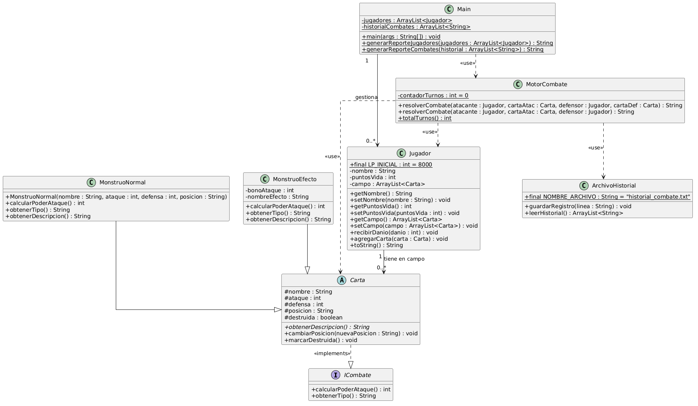

# Simulador Fase de Batalla - Yu-Gi-Oh!

Aplicacion de escritorio en Java que simula la Fase de Batalla del juego de cartas Yu-Gi-Oh!, aplicando las reglas de calculo de daño segun posición (Ataque vs Ataque, Ataque vs Defensa y Ataque Directo), gestion de Puntos de Vida (LP) y registro persistente del historial de combates.

## Requisitos y Ejecución
- JDK 17 o superior y Apache NetBeans con Maven.

- Ejecutar la clase principal main.Main.

- Para correr las pruebas unitarias, ejecutar modelo.MotorCombateTest con JUnit 5.

- Cada combate se registra automaticamente en el archivo historial_combate.txt en la raiz del proyecto.

## 1. Diseno UML

El modelo del sistema cuenta con 7 clases y 1 interfaz distribuidas para cubrir todos los conceptos de POO requeridos:



- **Clases e interfaz:** `ICombate` (interfaz), `Carta` (clase abstracta), `MonstruoNormal`, `MonstruoEfecto`, `Jugador`, `MotorCombate`, `ArchivoHistorial` y `Main`.
- **Relaciones aplicadas:**
  - *Implementacion:* `Carta` implementa `ICombate`.
  - *Herencia:* `MonstruoNormal` y `MonstruoEfecto` heredan de `Carta`.
  - *Asociacion:* `Jugador` mantiene una lista dinamica de cartas en campo (`ArrayList<Carta>`) y `Main` gestiona la lista de jugadores (`ArrayList<Jugador>`).
  - *Dependencia:* `MotorCombate` utiliza `ArchivoHistorial`, `Jugador` y `Carta` para ejecutar y registrar los combates; `Main` depende de `MotorCombate`.
- **Modificadores:** uso de `public`, `private`, `protected`, `abstract` (`Carta` y `obtenerDescripcion()`), `static` (`contadorTurnos`, `totalTurnos()` y metodos de reporte) y `static final` (`LP_INICIAL = 8000` y `NOMBRE_ARCHIVO = "historial_combate.txt"`).
- **Polimorfismo:**
  - *Sobreescritura (`@Override`):* `calcularPoderAtaque()`, `obtenerTipo()` y `obtenerDescripcion()` se comportan diferente en `MonstruoNormal` (ataque base) y `MonstruoEfecto` (ataque base mas bono).
  - *Sobrecarga:* `MotorCombate` implementa `resolverCombate(atacante, cartaAtac, defensor, cartaDef)` para combate entre monstruos y `resolverCombate(atacante, cartaAtac, defensor)` para ataque directo.
- **Reportes en `Main`:** `generarReporteJugadores(ArrayList<Jugador>)` y `generarReporteCombates(ArrayList<String>)` construidos sobre estructuras dinamicas.
- **Reglas del diagrama:** los getters, setters y `toString()` se representan unicamente en `Jugador`, y en todo el diagrama se incluye un unico constructor perteneciente a la subclase `MonstruoNormal`.

---

## 2. Codificacion, Arquitectura MVC y GUI (1.0 Punto)

El proyecto aplica estrictamente el patron **Modelo-Vista-Controlador (MVC)** con convenciones CamelCase y separacion en paquetes:

```text
src/
├── main/java/
│   ├── modelo/
│   │   ├── ICombate.java
│   │   ├── Carta.java
│   │   ├── MonstruoNormal.java
│   │   ├── MonstruoEfecto.java
│   │   ├── Jugador.java
│   │   ├── MotorCombate.java
│   │   └── ArchivoHistorial.java
│   ├── vista/
│   │   ├── VentanaBatalla.java
│   │   └── VentanaBatalla.form
│   ├── controlador/
│   │   └── ControladorBatalla.java
│   └── main/
│       └── Main.java
└── test/java/
    └── modelo/
        └── MotorCombateTest.java
```

- **Logica de combate y persistencia (modelo):** implementa las reglas de Ataque vs Ataque, Ataque vs Defensa y Ataque Directo, reduciendo LP y marcando cartas destruidas. Cada combate se almacena automaticamente en historial_combate.txt.

- **Interfaz grafica (vista):** VentanaBatalla fue construida mediante el diseñador visual JFrame Form de NetBeans, organizada en tres paneles (Jugadores y Puntos de Vida, Invocar Monstruo y Batalla e Historial) sin logica de negocio en la vista.

- **Controlador y mejoras adicionales (controlador):** ControladorBatalla enlaza todos los eventos desde fuera de la vista, precarga monstruos iniciales al comenzar el duelo para agilizar las pruebas, bloquea el ingreso de letras en campos numericos mediante KeyListener, habilita los campos de efecto solo para monstruos de tipo Efecto y controla excepciones (NumberFormatException e IllegalArgumentException).

## 3. Pruebas Unitarias con JUnit
La logica matematica del combate y la gestion de LP operan de manera independiente a la GUI y estan validadas con JUnit 5 en src/test/java/modelo/MotorCombateTest.java (8 casos de prueba):

| Caso de prueba | Escenario validado | 
| --- | --- |
testAtaqueVsAtaqueGanaAtacante | Destruccion del defensor y reduccion de LP por diferencia de ATQ |
testAtaqueVsAtaqueGanaDefensor | Destruccion del atacante y dano reflejado al jugador atacante | 
|testAtaqueVsAtaqueEmpate | Destruccion de ambos monstruos sin perdida de LP|
|testAtaqueVsDefensaSuperaDefensa | Destruccion del defensor en defensa con 0 dano a LP|
|testAtaqueVsDefensaNoSuperaDefensa|Sin destruccion y dano al atacante por diferencia DEF - ATQ|
|testAtaqueDirectoConMonstruoEfecto|Polimorfismo de MonstruoEfecto (ATQ + bono) en ataque directo|
|testCartaEnDefensaNoPuedeAtacar | Lanzamiento de IllegalArgumentException al intentar atacar en defensa|
|testPuntosVidaNoBajanDeCero | Limite inferior de 0 LP cuando el dano supera la vida restante|
